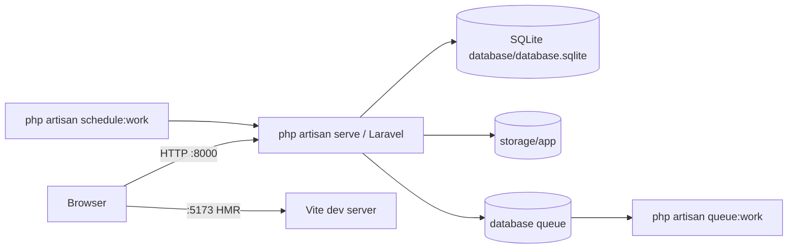
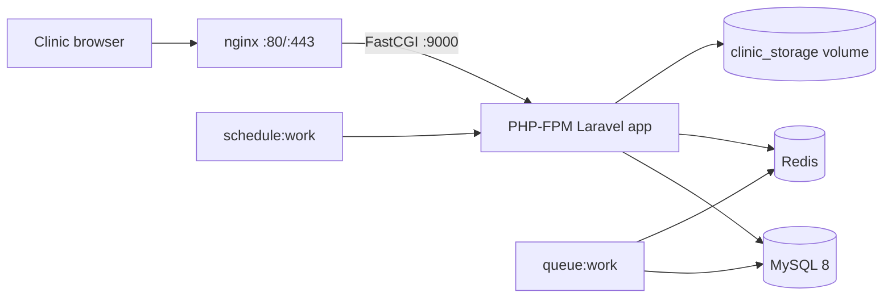

# Architecture

## 1. Executive summary

DentalCare is a **modular monolith**: one Laravel application serving two frontends and several business domains. It is multi-tenant at the `Practice` level and supports multiple `Branch` locations per practice. The two frontends are:

1. **Filament v3 admin panel** at `/admin/{practice}` — the primary operational UI for patients, appointments, treatment, billing, labs, inventory, insurance, staff, and settings.
2. **Inertia + React app** — the public welcome page, onboarding wizard, finance dashboard, calendar, analytics, support, error pages, and the 3D odontogram.

There is also a **system panel** at `/system` for developers/super-admins to manage practices and support tickets.

The application deliberately keeps business logic in service classes (`app/Services`) and uses Eloquent observers for a few automatic side effects (practice demo seeding, consultation invoicing, post-op WhatsApp messages). Background work is handled by database/Redis queues and a small scheduler.

## 2. Runtime topology

### Local



### Docker / production



The production compose file (`docker-compose.prod.yml`) runs `nginx`, `app`, `worker`, `scheduler`, `db`, and `redis`. The development compose file bind-mounts the source tree and is not equivalent to production. See [DEPLOYMENT.md](DEPLOYMENT.md).

## 3. Request lifecycle

### Web / Inertia requests

1. `public/index.php` boots Laravel.
2. Global middleware runs. The web group appends:
   - `App\Http\Middleware\SetLocale`
   - `App\Http\Middleware\HandleInertiaRequests`
3. Route middleware runs:
   - `auth` where declared
   - `onboarding` → `EnsureOnboardingIsCompleted`
   - `feature:<key>` → `RequireFeature`
4. Controller returns either an Inertia response or JSON.
5. `HandleInertiaRequests` shares `appName`, `auth.user`, `locale`, `direction`, `availableLocales`, `translations`, and flash messages with every Inertia page.

Guests are redirected to `filament.admin.auth.login` by `bootstrap/app.php`. CSRF validation is disabled globally for `api/*` (see [SECURITY.md](SECURITY.md#c6--csrf-disabled-for-all-api-high)).

### Filament admin requests

The admin panel adds its own middleware stack and tenant middleware:

```text
EncryptCookies
AddQueuedCookiesToResponse
StartSession
AuthenticateSession
SetLocale
ShareErrorsFromSession
VerifyCsrfToken
SubstituteBindings
DisableBladeIconComponents
DispatchServingFilamentEvent
→ panel auth: Authenticate
→ tenant middleware: CheckLicenseStatus
```

Filament resolves the tenant from the `{tenant}` route parameter (`Practice`), checks `User::canAccessTenant()`, and scopes resources using the panel's tenancy configuration plus the application's policies and explicit `practice_id` filters.

### System panel requests

`/system` uses the same base middleware but **no tenant middleware and no license middleware**. It is accessible to `developer` and `super_admin` roles only, via `User::canAccessPanel()`.

## 4. Multi-tenancy

### Tenant hierarchy

```text
Practice (tenant root)
├── Branch (physical location)
│   ├── Operatory
│   └── appointments
├── User (practice_id, optional branch_id)
├── Patient (practice_id)
│   ├── MedicalHistory
│   ├── DentalExamination → ToothFinding → ToothSurfaceFinding
│   ├── PatientTooth
│   ├── TreatmentPlan → TreatmentPhase → TreatmentProcedure
│   ├── Invoice → InvoiceItem / Payment / InstallmentPlan
│   ├── Appointment
│   ├── LabOrder
│   └── VoiceNote / PatientFile / Prescription
├── InventoryItem → InventoryBatch / InventoryStockMovement
├── Supplier / DentalLab / InsuranceProvider / StaffMember
├── ClinicExpense / PayrollSlip / DoctorCommission
└── SupportTicket / CommunicationLog / WhatsAppAppointmentRequest
```

### How isolation is enforced

There is no single global tenant scope. Isolation is achieved through a combination of:

1. **Filament tenancy** — `AdminPanelProvider` declares `->tenant(Practice::class)`, and access is checked by `User::canAccessTenant()`.
2. **Explicit `practice_id` filters** — services and controllers generally query by `practice_id` (for example `AnalyticsService`, `DashboardWidgetController`, finance routes).
3. **Policies** — `app/Policies/*` combine role checks with `practice_id` equality for records that have a direct practice column.
4. **Relationship checks** — for records without `practice_id` (e.g. `TreatmentPlan`, `TreatmentProcedure`), authorization walks up to the patient.
5. **`Gate::before`** — `developer` and `super_admin` bypass all ability checks. This is intentional but makes those roles extremely powerful.

### Weak points

- Several clinical APIs only check ownership **if the user is authenticated**:

  ```php
  if (auth()->check() && auth()->user()->practice_id) {
      abort_unless($patient->practice_id === auth()->user()->practice_id, 403);
  }
  ```

  An unauthenticated request skips the check entirely. These routes are not behind `auth` middleware. This is a critical issue; see [SECURITY.md](SECURITY.md#c3--unauthenticated-clinical-apis-critical).

- `patients` has no `branch_id`, while analytics and some queries filter on `patients.branch_id`. On SQLite, `"branch_id"` in a `where` clause is treated as a string literal, silently returning no rows instead of erroring. On MySQL it would error. See [DATA_MODEL.md](DATA_MODEL.md#6-schema-gaps-and-gotchas).

- A few controllers fall back to practice `1` or the first user when context is missing. Treat these as bugs, not as tenancy primitives.

### Roles

Roles are stored by Spatie Laravel Permission:

| Role | Typical use | Panel access |
| --- | --- | --- |
| `developer` | Vendor/developer; all tenants; system panel | `system`, `admin` |
| `super_admin` | Clinic group owner / vendor super admin; all tenants | `system`, `admin` |
| `clinic_admin` | Single-clinic administrator | `admin` |
| `doctor` | Clinical work | `admin` |
| `secretary` | Reception, appointments, payments | `admin` |

`User::canAccessPanel()`:

- `system` panel → `developer`, `super_admin`
- `admin` panel → `doctor`, `secretary`, `clinic_admin`, `super_admin`, `developer`

Policies encode finer-grained permissions (patient create/delete, invoice create, treatment plan create, user management, inventory adjustment, etc.). `Gate::before` grants every ability to `developer` and `super_admin`.

### Panel URLs

- `/admin` → tenant chooser / redirect
- `/admin/{practice}` → tenant dashboard
- `/admin/{practice}/patients`
- `/admin/{practice}/appointments`
- `/admin/{practice}/invoices`
- `/admin/{practice}/inventories`
- `/admin/{practice}/whats-app-settings`
- `/system/practices`
- `/system/support-tickets`

## 5. Authentication

- Session-based Laravel auth; Filament login pages are the primary entry point.
- `/login` redirects to the Filament admin login.
- `/register`, `/auth/Register`, `/auth/Login` all redirect to `/quick-login`.
- `/quick-login` logs in an existing user with no credential check. This is a development convenience and a production blocker.
- Sanctum is installed (`laravel/sanctum`) but not used for the current APIs; there is no `routes/api.php`.
- The APIs share the web session and are protected (where protected at all) by the `auth` middleware.

## 6. Feature flags

`App\Services\FeatureManager::FEATURES` defines the catalog. Flags are stored in `practices.features` as a flat JSON array, e.g. `["finance","inventory"]`.

| Key | Name | System-only | Default |
| --- | --- | --- | --- |
| `3d_model` | 3D Odontogram Viewer | yes | off |
| `whatsapp` | WhatsApp Integration | yes | off |
| `ai_analysis` | AI X-Ray Analysis | yes | off |
| `inventory` | Inventory Management | no | on |
| `finance` | Finance & Billing | no | on |
| `installments` | Installment Plans | no | on |
| `labs` | Dental Labs & Orders | no | on |
| `insurance` | Insurance & Claims | no | on |
| `payroll` | Staff Payroll Slips | no | on |

Behavior:

- `Practice::hasFeature()` supports the current flat array and the legacy associative `['key' => true]` format.
- `FeatureManager::isEnabled()` falls back to the current Filament tenant, then the auth user's practice, then the feature default.
- `RequireFeature` aborts with 403 for web and JSON requests.
- `FeatureManager::updatePracticeFeatures()` prevents clinic users from changing system-only flags or another practice's flags.
- System-only flags are intended to be toggled only from `/system/practices`.

Note: in `AdminPanelProvider`, `3d_model` gating is applied to the odontogram routes, but the 3D tab inside `PatientResource` checks the tenant feature directly. Other resources (finance, inventory, labs, insurance, payroll) do not consistently hide navigation based on their flag; the flags mainly gate routes and widget categories.

## 7. Licensing and tamper-resistant clock

Two separate concepts exist:

1. **Per-practice license fields** — `practices.license_key`, `practices.license_status` (shown in `/system/practices`). These are informational/administrative; the middleware does **not** consult them.
2. **Installation license** — `App\Services\LicenseManager` with an encrypted file (`storage/app/license.enc`) and a tamper-resistant clock (`storage/app/license_clock.enc` + `license_clock_ticks` table).

`LicenseManager`:

- `activate($rawKey)` calls `{LICENSE_SERVER_URL}/api/license/activate` with a hardware fingerprint and stores a hashed key plus server signature.
- `getLicenseState()` returns `active`, `inactive`, `grace_warning` (48h), `grace_urgent` (66h), `expired_grace` (72h), `suspended`, `revoked`, `tampered`, or `error`.
- `sendHeartbeat()` calls `/api/license/heartbeat`, resets the clock on success, and handles remote suspension/revocation.
- Local environment (`APP_ENV=local`) bypasses lockout entirely. Testing also bypasses.

`TamperProofClock` accumulates elapsed time using:

- monotonic `hrtime()` while the process is running
- validated OS-clock gaps between sessions (forward-only)
- encrypted file state cross-validated against the `license_clock_ticks` table
- rollback detection → tamper flag → immediate grace expiry

Scheduler (`routes/console.php`):

```php
Schedule::command('license:tick')->everyTenMinutes();
Schedule::command('license:heartbeat')->everyFourHours();
```

**Important gap:** no controller, page, or command calls `LicenseManager::activate()`. The system panel edits `practices.license_key`/`license_status`, but that does not create `license.enc`. The Windows installer writes `license.json`, which `LicenseManager` does not read. As shipped, a production installation has no supported activation path. See [DEPLOYMENT.md](DEPLOYMENT.md#5-license-activation) and [RECOMMENDATIONS.md](RECOMMENDATIONS.md#p0-6-remove-public-license-mocks-and-fix-license-activation).

## 8. Domain modules at a glance

| Domain | Main models | Primary UI | Key services / side effects |
| --- | --- | --- | --- |
| Tenancy & onboarding | `Practice`, `Branch`, `User` | `/system/practices`, `/onboarding` | `FeatureManager`, `CurrencyHelper`, `LanguageHelper` |
| Patients | `Patient`, `MedicalHistory`, `PatientFile`, `Prescription` | `PatientResource` | Patient 360 tabs/widgets |
| Appointments | `Appointment`, `Operatory` | `AppointmentResource`, `OperationResource`, calendar | `AppointmentObserver` auto-invoices consultation fee |
| Odontogram | `DentalExamination`, `ToothFinding`, `ToothSurfaceFinding`, `PatientTooth`, legacy `ToothRecord`/`SurfaceCondition` | 3D viewer, patient tab | `PatientOdontogramController`, `DentalExaminationController` |
| Treatment | `TreatmentPlan`, `TreatmentPhase`, `TreatmentProcedure`, `ProcedureCode` | relation manager, APIs | `InvoiceGenerationService`, `TreatmentProcedureObserver` |
| Billing | `Invoice`, `InvoiceItem`, `Payment`, `InstallmentPlan`, `InstallmentSchedule`, `DoctorCommission`, `ClinicExpense` | finance resources + `/finance` | `Invoice::recalculateTotals()` |
| Labs | `DentalLab`, `LabOrder` | `DentalLabResource`, `LabOrderResource` | lab widgets |
| Inventory | `Supplier`, `InventoryItem`, `InventoryBatch`, `InventoryStockMovement`, `ProcedureConsumption` | `InventoryResource`, `SupplierResource` | `InventoryStockService` (FIFO/FEFO) |
| Insurance | `InsuranceProvider`, `PatientInsurancePolicy`, `InsuranceClaim` | insurance resources | — |
| HR / payroll | `StaffMember`, `PayrollSlip`, `DoctorCommission` | staff/payroll resources | commission calculation |
| Communication | `CommunicationLog`, `WhatsAppAppointmentRequest`, `VoiceNote` | WhatsApp settings, patient tabs | `WhatsAppWebhookController`, queue jobs, `GeminiService` |
| Analytics | aggregated queries | `/analytics`, dashboard widgets | `AnalyticsService`, `DashboardWidgetEngine` |
| Support | `SupportTicket`, `SupportTicketReply` | `/support`, system resource | `NotificationService` |
| Platform | `Practice`, `license_clock_ticks` | `/system` | `LicenseManager`, `TamperProofClock` |

## 9. Services and business logic

Business logic is concentrated in `app/Services`:

| Service | Responsibility |
| --- | --- |
| `InvoiceGenerationService` | Creates an invoice from billable treatment procedures, prevents double-invoicing, recalculates totals |
| `InventoryStockService` | Adds/subtracts stock, creates batches, FIFO depletion, writes stock movements, enforces tenant/policy checks |
| `DashboardWidgetEngine` | Registry, ordering, user preferences, feature-flag filtering, payload assembly |
| `Widgets\FinanceWidgetService` | Gross production, collections, AR, commissions |
| `Widgets\InventoryWidgetService` | Low stock, expiring batches, consumption rate, valuation |
| `AnalyticsService` | Production, collections, AR, no-shows, operatory utilization, top procedures, acquisition, branch metrics |
| `FeatureManager` | Feature catalog, enablement checks, tenant-safe updates |
| `CurrencyHelper` | Multi-currency options and formatting |
| `LanguageHelper` | Locale resolution, RTL, frontend translation dictionary |
| `NotificationService` | Deduplicated database/broadcast/web-push notifications |
| `LicenseManager` | Activation, heartbeat, status, lockout |
| `TamperProofClock` | Anti-rollback elapsed-time tracking |
| `HardwareFingerprint` | Machine identity for license binding |
| `WhatsAppService` | Legacy/mock WhatsApp sender (currently always returns `true`) |
| `GeminiService` | Gemini text/audio parsing for appointment requests |
| `ClinicalPresets` | Predefined clinical note/tooth presets |

## 10. Observers, jobs, and scheduler

### Observers (registered in `AppServiceProvider::boot`)

| Observer | Event | Effect |
| --- | --- | --- |
| `PracticeObserver` | `created` | Seeds inventory + catalog + lab data for every new practice. Dental uses `DentalInventorySeeder`; ophthalmology uses eye seeders. This is the cause of test OOM and huge demo databases. |
| `AppointmentObserver` | `created` / `updated` | Creates/updates an invoice for `consultation_fee`. |
| `TreatmentProcedureObserver` | `updated` | Sets `completed_at`; sends a post-op WhatsApp message for extraction/implant/root-canal codes via `WhatsAppService` (currently a mock). |

### Jobs

| Job | Purpose |
| --- | --- |
| `SendWhatsAppMessageJob` | Calls Evolution API directly. |
| `SendWhatsAppListMessageJob` | Sends an interactive list via Evolution API. |
| `SendPostOpCheckupJob` | Sends a post-op follow-up; currently hardcodes `Practice::find(1)`. |

### Scheduler

Only the two license commands are scheduled. There are no scheduled appointment reminders, invoice overdue checks, or inventory expiry jobs in `routes/console.php`, even though notification classes exist. Any such jobs must currently be triggered manually or are missing.

## 11. Notifications and PWA

- Notifications use Laravel's `database` and `broadcast` channels and, when the package is present, the Web Push channel.
- Filament's database notifications poll every 3 seconds.
- `resources/views/filament/push-subscription.blade.php` registers `/sw.js` and subscribes using `VAPID_PUBLIC_KEY` read via `env()`.
- `public/sw.js` and `public/manifest.json` provide basic PWA behavior.
- `NotificationService::sendUnique()` suppresses duplicate notifications within 24 hours using a `dedup_key` in the notification payload.
- The Inertia `NotificationCenter` component fetches `/api/notifications`, which is user-scoped and authenticated.

## 12. Frontend architecture

### Inertia entry point

`resources/js/app.jsx`:

- imports `resources/css/app.css`
- creates the Inertia app
- resolves pages from `./Pages/**/*.{jsx,tsx}`, trying `.tsx` first
- wraps every page layout in `LocaleProvider`
- uses `VITE_APP_NAME` for the document title

Shared page props come from `HandleInertiaRequests` (locale, direction, translations, auth user, flash).

### Pages

| Page | Status |
| --- | --- |
| `Welcome/Welcome.jsx` | Public marketing page |
| `onboarding.jsx` | 5-step clinic setup wizard |
| `finance.jsx` | Finance dashboard, feature-gated |
| `calendar.jsx` | Detailed calendar |
| `analytics.jsx` | Analytics dashboard |
| `support.jsx` | Helpdesk |
| `Dental/Test3DOdontogram.tsx` | 3D odontogram |
| `Error.jsx` | Inertia error page |
| `dashboard.jsx` | **empty file (0 bytes)** |
| `auth/Login.jsx`, `Regester.jsx` | **empty placeholder files** |
| `patiants.jsx`, `operations.jsx`, `inventory.jsx`, `insurance.jsx`, `labs.jsx` | small placeholder views |

### 3D stack

- `Dental3DViewer` loads `/models/teeth-seperated-optimized.glb` (about 31 MB) or per-tooth assets from `/models/optimized/*.glb`.
- `InteractiveTooth` and `SingleToothViewer` handle picking and per-tooth rendering.
- `VoiceNoteModal` plays post-op audio.
- `types.ts` defines tooth/condition types.
- Draco decoder assets live in `public/draco`.
- Total `public/models` size is about 263 MB, which matters for repository size, Docker build time, and page performance.

### Styling

- Tailwind CSS 4 via `@tailwindcss/vite`.
- `resources/css/app.css` declares sources for Blade, JS/JSX/TS/TSX, and Laravel pagination views.
- Custom components in `resources/js/Components` (`Button`, `Card`, `Badge`, `Sidebar`, `Navbar`, `NotificationCenter`, etc.).
- Dark mode is partially supported through `ThemeContext` and `?dark=1`.

## 13. File storage and generated documents

| Content | Location | Notes |
| --- | --- | --- |
| Patient files / X-rays | configured filesystem, commonly `storage/app` | 100 MB nginx body limit |
| Voice notes | `storage/app/voice_notes/{practice}/{patient}/` | private; streamed through token or authenticated route |
| Prescriptions | rendered Blade + DomPDF | `resources/views/prescriptions/print.blade.php` |
| License / clock state | `storage/app/license.enc`, `license_clock.enc` | AES-256-GCM, key derived from `APP_KEY` |
| 3D models | `public/models` | large static assets |
| Public build | `public/build` | generated by Vite; gitignored |
| SQLite dev DB | `database/database.sqlite` | gitignored, 24 MB in the audit environment |

## 14. Localization

- Supported locales: `en`, `ar` (RTL), `fr`.
- Resolution order in `LanguageHelper::currentLocale()`:
  1. session
  2. authenticated user's `locale`
  3. active Filament tenant's `locale`
  4. first practice's `locale`
  5. `config('app.locale')`
- `SetLocale` applies the locale and sets Carbon/MySQL locale where applicable.
- `/locale/{lang}` stores the choice in session and on the user.
- `lang/{en,ar,fr}.json` holds UI strings; PHP validation/auth translations live in `lang/en`.
- `resources/views/app.blade.php` sets `<html dir="...">` from `LanguageHelper::direction()`.
- Filament has a language-switch render hook.

## 15. Configuration and environment

- Standard Laravel config in `config/*.php`.
- Custom license config in `config/license.php`.
- `config/services.php` only contains Laravel defaults; WhatsApp/Evolution/Gemini/VAPID are **not** registered there.
- Several runtime calls use `env()` directly (`GeminiService`, WhatsApp jobs/pages, push-subscription Blade). This works only when config caching is off. In production with `php artisan config:cache`, those values become `null`.
- `.env.example` is still the Laravel skeleton and omits all integration and license variables.

## 16. Key design decisions and trade-offs

### Two frontends instead of one

**Why it exists:** Filament provides fast CRUD/admin screens; Inertia/React provides custom dashboards and the 3D experience.

**Trade-offs:**

- duplicated navigation and styling
- some pages are placeholders
- two auth surfaces (`/admin` and `/`)
- API endpoints live in `routes/web.php`, so they use session auth instead of token auth

### Practice as tenant, branch as location

**Why:** supports clinic groups and multi-location practices.

**Trade-offs:**

- many models carry `practice_id` directly; some only reach it through relationships
- `patients` lacks `branch_id`, so branch-level reporting is incomplete
- `super_admin`/`developer` bypass tenant restrictions by design

### Observers for side effects

**Why:** automatic demo data and automatic consultation invoices reduce manual setup.

**Trade-offs:**

- creating a `Practice` is very expensive (~5,000 inventory rows)
- tests that create practices inherit demo data and fail
- side effects are hard to disable selectively
- an appointment can create financial records implicitly

### Global installation license + per-practice license fields

**Why:** supports on-premise licensing per machine while still showing per-clinic status in the vendor panel.

**Trade-offs:**

- two sources of truth
- no activation UI for the actual `LicenseManager`
- installer writes a format the manager does not read

### Session APIs in `web.php`

**Why:** fastest path for the Inertia frontend.

**Trade-offs:**

- CSRF is disabled for all `api/*`
- no token auth for mobile/third-party clients
- tenant checks are easy to forget
- the route file mixes web pages and API endpoints

## 17. Extension points

### Add a Filament resource

1. Create `app/Filament/Resources/YourResource.php` and a `Pages/` subdirectory.
2. Set `$navigationGroup` to one of the configured groups.
3. Add a policy in `app/Policies`.
4. If the model has `practice_id`, ensure it is fillable and scoped; if not, add relationship-based authorization.
5. Add the model to the relevant relationship managers/tabs if needed.

### Add a feature flag

1. Add an entry to `FeatureManager::FEATURES` with `key`, `name`, `category`, `system_only`, `default`.
2. Gate routes with `->middleware('feature:your_key')`.
3. Hide navigation/widgets with `FeatureManager::isEnabled('your_key')`.
4. Update `/system/practices` form if it needs special handling.
5. Add tests for enabled/disabled behavior.

### Add an API endpoint

Prefer creating `routes/api.php` and using Sanctum, but if you must follow the current pattern:

1. Add the route in `routes/web.php`.
2. Put it inside the `auth` middleware group.
3. Resolve the tenant from the authenticated user, never from a request parameter alone.
4. Add a policy/ownership check even when `auth` is present.
5. Return JSON consistently.
6. Add a feature test for cross-tenant access.

### Add a scheduled job

1. Create the command or job.
2. Schedule it in `routes/console.php`.
3. Ensure `php artisan schedule:work` or cron is running.
4. Make it idempotent and tenant-aware.
