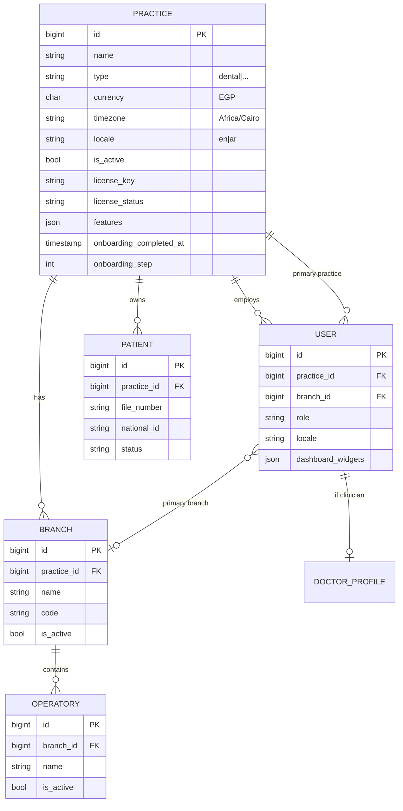
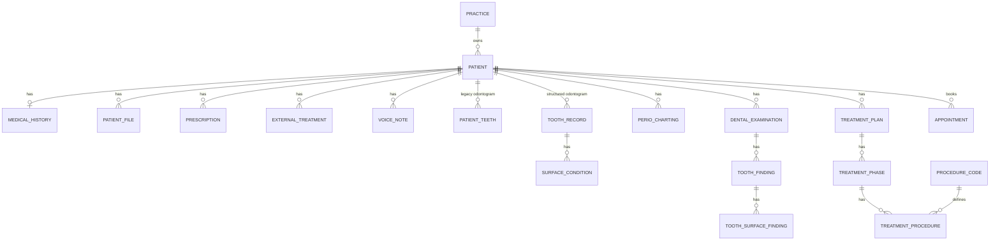
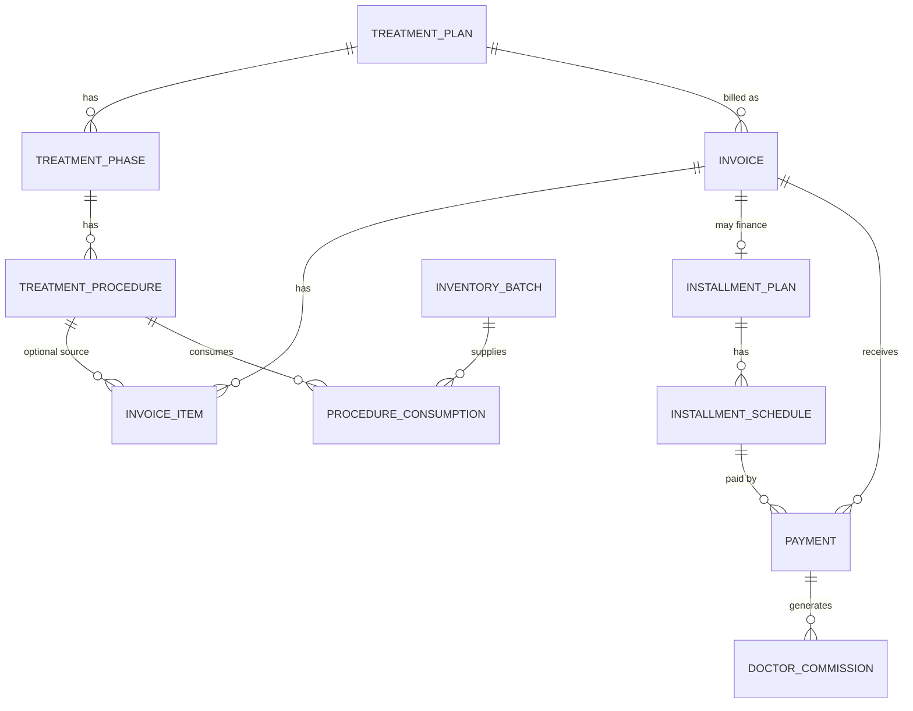
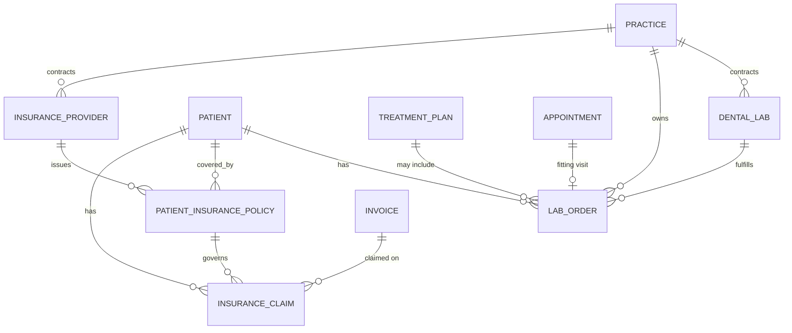

# Data model

The schema is a single-tenant-per-database-style design with a shared database and a `practice_id` discriminator on most top-level tables. There are **no Eloquent global scopes**: tenant isolation is enforced by Filament's tenant scoping, policies, and explicit `where('practice_id', ...)` filters. Any new query written outside those paths must add the filter itself.

- Database: SQLite for local development (`database/database.sqlite`), MySQL 8 in Docker/production.
- 64 tables in the audited database.
- Timestamps are Eloquent `created_at` / `updated_at` unless noted.
- Money is `decimal(10,2)` throughout. Percentages are `decimal(5,2)`.
- Clinical tooth numbers use FDI notation (`11`–`48` adult, `51`–`85` pediatric).

## 1. Tenancy hierarchy

Ownership rules:

| Level | Table | Rule |
| --- | --- | --- |
| Tenant root | `practices` | One row per clinic/subscription. Owns almost everything. |
| Location | `branches`, `operatories` | Belong to a practice through `practice_id` → `branch_id`. |
| Identity | `users` | `practice_id` and `branch_id` are nullable, so a user can exist without a tenant (this is why seeded `admin@dentalcare.com` has no access). |
| Clinical | `patients` | Always has `practice_id`. Clinical children derive tenancy through `patient_id`. |
| Finance / ops | `invoices`, `payments`, `inventory_items`, `lab_orders`, `staff_members`, … | Carry their own `practice_id` for direct filtering and reporting. |
| Derived | `treatment_plans`, `treatment_phases`, `treatment_procedures`, `dental_examinations`, `prescriptions`, `patient_files`, `perio_chartings`, `tooth_records` | **No `practice_id`.** Tenancy must be resolved through the patient/treatment plan graph. |

Users can belong to more than one practice through the Filament tenant mechanism (`getTenants()` returns a collection; `canAccessTenant()` compares `practice_id`). The `model_has_roles` pivot is not team-scoped, so a role granted in one practice applies globally to that user.

## 2. Table catalog by domain

### 2.1 Platform / framework

| Table | Purpose | Notes |
| --- | --- | --- |
| `users` | Login identity, role, tenant pointer, UI locale, dashboard widget layout | One role string, not a role table; Spatie roles also exist in parallel. |
| `password_reset_tokens`, `sessions`, `cache`, `cache_locks` | Laravel infrastructure | `sessions` is used when `SESSION_DRIVER=database`. |
| `jobs`, `job_batches`, `failed_jobs` | Queue infrastructure | `QUEUE_CONNECTION=database` by default. |
| `permissions`, `roles`, `model_has_permissions`, `model_has_roles`, `role_has_permissions` | Spatie Permission | Roles used: `super_admin`, `clinic_admin`, `developer`, `doctor`, `secretary` (per seeders/policies). |
| `notifications` | Laravel database notifications + PWA payloads | `notifiable` morph. |
| `push_subscriptions` | Web Push endpoints | Polymorphic `subscribable`; currently used by users. |
| `license_clock_ticks` | Tamper-proof clock heartbeat | Append-only `tick_sequence` + `accumulated_seconds`. |

### 2.2 Patients and clinical history

| Table | Purpose | Key columns |
| --- | --- | --- |
| `patients` | Demographics and bot state | `practice_id`, `file_number`, `national_id`, `status`, `bot_state`, `bot_step`, `bot_data` |
| `medical_histories` | One row per patient, medical risk flags | `patient_id` unique; diabetes/cardiac/bleeding/allergy flags; detailed fields added later |
| `patient_teeth` | Legacy simple odontogram | `patient_id`, `tooth_number` (string), `condition`, `surfaces` json |
| `tooth_records` | Structured odontogram | `patient_id` + `tooth_number_fdi` unique; mobility, furcation, missing, impacted |
| `surface_conditions` | Conditions per tooth surface | `tooth_record_id`, `surface`, `condition_code`, `status`, `material` |
| `perio_chartings` | Periodontal exam snapshots | `patient_id`, `exam_date`, 6-site probe JSON, bleeding JSON |
| `dental_examinations` | Visit-based exam header | `patient_id`, `doctor_id`, `type`, `examined_at`, `status` |
| `tooth_findings` | Findings per exam | `dental_examination_id` + `tooth_number_fdi` unique |
| `tooth_surface_findings` | Findings per surface per exam | `tooth_finding_id` + `surface` unique |
| `patient_files` | X-rays, photos, consent forms | `patient_id`, `doctor_id`, `type`, `file_path`, `tooth_number_fdi` |
| `prescriptions` | Medication orders | `patient_id`, `doctor_id`, drug/dose/frequency/duration, `status` |
| `external_treatments` | Treatment done elsewhere | `patient_id`, `procedure_title`, `performed_year`, `attachments_json` |
| `voice_notes` | Audio notes with share links | `practice_id`, `patient_id`, `share_token` unique, expiry/revocation |

### 2.3 Scheduling

| Table | Purpose | Key columns |
| --- | --- | --- |
| `appointments` | Booked visit | `practice_id`, `branch_id`, `operatory_id`, `patient_id`, `doctor_id`, `treatment_procedure_id`, `start_time`, `end_time`, `status`, `type`, `parent_appointment_id`, `procedure_name`, `tooth_number`, `consultation_fee` |
| `whatsapp_appointment_requests` | Patient-requested slots from the bot | `practice_id`, `patient_id`, `requested_date`, `requested_time`, `status` |

Appointment statuses: `booked`, `arrived`, `in_chair`, `completed`, `no_show`, `cancelled`. Types: `new_visit`, `follow_up`.

### 2.4 Treatment planning

| Table | Purpose |
| --- | --- |
| `procedure_categories` | Diagnostic, preventive, restorative, endo, perio, prostho, surgery, ortho |
| `procedure_codes` | Catalog of billable procedures (CDT-like `code`, `title`, `standard_fee`, `estimated_duration_minutes`) |
| `treatment_plans` | Header per patient: `doctor_id`, `status`, totals (`total_amount`, `discount_amount`, `net_amount`) |
| `treatment_phases` | Ordered phases inside a plan (`sequence`, `name`) |
| `treatment_procedures` | Line items: tooth, surface, procedure code, doctor, fee, discount, net, status, execution fields (`anesthetic_agent`, `materials_used_json`, `hemostasis_achieved`, `chairside_notes`) |

`TreatmentPlan::recalculateTotals()` recomputes plan totals from procedures. `TreatmentProcedureObserver` recalculates the parent plan when a procedure changes.

### 2.5 Billing and finance

| Table | Purpose | Notes |
| --- | --- | --- |
| `invoices` | Patient invoice | `invoice_number` globally unique; `subtotal`, `discount_amount`, `tax_amount`, insurance amounts; `status` unpaid/partially_paid/paid/overdue/cancelled |
| `invoice_items` | Invoice lines | `invoice_id`, optional `treatment_procedure_id`, `description`, `quantity`, prices, plus an `invoiceable_type/id` morph (used for appointment consultation fees) |
| `installment_plans` | Financing per invoice | funded amount, down payment, count, frequency, status |
| `installment_schedules` | Individual installments | `schedule_number`, `due_date`, `amount`, `paid_amount`, status |
| `payments` | Money received | `practice_id`, `invoice_id`, optional `installment_schedule_id`, method, reference, `paid_at` |
| `doctor_commissions` | Doctor share of a payment | `gross_amount`, `lab_deduction_amount`, `commission_percentage`, `commission_amount`, status |
| `clinic_expenses` | Operating expenses | `expense_number`, category, payee, supplier/lab links, recurring flags |

Billing invariants implemented in models:

- `Payment::saved` recalculates the invoice (`Invoice::recalculateTotals()`) and updates the linked installment schedule's `paid_amount`/status.
- `Invoice::recalculateTotals()` derives `paid_amount` from payments, `balance_due`, and status. Overpayment is clamped to zero in the UI, not at the DB level.
- `DoctorCommission::calculateCommission($gross, $labCost, $percentage)` = `max(0, gross - labCost) * percentage / 100`, rounded to 2 decimals.
- Invoice numbers are generated on `creating` as `INV-{year}-{00001}` using `max(id)+1`. This is race-prone under concurrency and can collide across practices because the number is globally unique.

### 2.6 Laboratories

| Table | Purpose |
| --- | --- |
| `dental_labs` | Vendor directory: type, account number, turnaround days, rating, pricing tier, courier |
| `lab_orders` | Case: patient, doctor, lab, tooth/teeth, shade system, material, impression type, digital scan URL, cost, patient charge, status, tracking number, fitting appointment, redo count, warranty, QC flags |

`lab_orders.status`: `impression_sent`, `in_production`, `shipped_by_lab`, `received_at_clinic`, `delivered`, `fitted`, `returned_for_redo`.

A lab order links to a treatment plan through `treatment_plan_id` (added in `2026_08_26_171029`).

### 2.7 Inventory and suppliers

| Table | Purpose |
| --- | --- |
| `suppliers` | Vendor master data, payment terms, lead time |
| `inventory_items` | Catalog: SKU, barcode, brand, category, unit, reorder level, unit/selling price, storage location, expiry flag |
| `inventory_batches` | Stock lots: batch number, expiry, unit cost, received/remaining quantity |
| `inventory_stock_movements` | Audit trail: addition/subtraction/purchase/waste/expired/adjustment, before/after quantities |
| `procedure_consumptions` | Materials consumed by a treatment procedure, linked to a batch |

Inventory rules:

- Stock on hand = `sum(inventory_batches.quantity_remaining)` — there is no denormalized counter on `inventory_items`.
- Costing is batch-level (`unit_cost` per batch), but consumption does **not** currently write FIFO/FEFO cost into the treatment procedure.
- `InventoryBatch` expiry status: expired, expiring within 60 days, otherwise active.
- `InventoryStockMovement` records `previous_quantity` and `resulting_quantity`, so it is the authoritative audit log even if a batch row is edited.

### 2.8 People, payroll, insurance

| Table | Purpose |
| --- | --- |
| `staff_members` | HR record, optionally linked to a `user_id`; employee ID globally unique |
| `payroll_slips` | Monthly slip per staff member: base, overtime, bonus, allowance, deductions, net, status |
| `insurance_providers` | Payer directory with reimbursement SLA |
| `patient_insurance_policies` | Coverage details: annual max, deductible, preventive/basic/major/ortho percentages |
| `insurance_claims` | Claim header tied to patient, provider, policy, invoice, doctor; statuses draft → submitted → adjudicated |

### 2.9 Communication, support, licensing

| Table | Purpose |
| --- | --- |
| `communication_logs` | Inbound/outbound WhatsApp/SMS/email messages with external message ID |
| `support_tickets` | Ticket header with ticket number (`TKT-…`), practice, user, priority, status |
| `support_ticket_replies` | Thread messages, `is_staff_reply` |
| `license_clock_ticks` | Monotonic license clock; used by `LicenseManager` to detect OS clock rollback |

## 3. Core ER diagrams

### 3.1 Patient clinical graph

### 3.2 Treatment → billing

### 3.3 Labs and insurance

## 4. Odontogram data duplication (important)

There are **three** overlapping representations of tooth state. This is the single most confusing part of the schema:

| Model | Table | Shape | Written by |
| --- | --- | --- | --- |
| `PatientTooth` | `patient_teeth` | One row per tooth, string `tooth_number`, single `condition`, JSON `surfaces` | Legacy Inertia odontogram (`PatientOdontogramController`), and the 360° widget as a compatibility mirror |
| `ToothRecord` + `SurfaceCondition` | `tooth_records` + `surface_conditions` | Structured per-tooth record with multiple surface conditions and statuses | Seeders and some Filament actions; not consistently used by the React UI |
| `DentalExamination` + `ToothFinding` + `ToothSurfaceFinding` | `dental_examinations`, `tooth_findings`, `tooth_surface_findings` | Visit-scoped snapshot of findings | `DentalExaminationController`, the Filament exam UI |

`DentalExaminationController::updateFinding()` deliberately dual-writes into `patient_teeth` so the 360° profile stays in sync. There is a one-off command `php artisan odontogram:migrate` (`MigrateOdontogramData`) that copies `patient_teeth` into `dental_examinations`, but no continuous synchronization in the other direction.

Practical guidance:

- Treat `dental_examinations` as the forward-looking source of truth for new features.
- Read `patient_teeth` only for backward compatibility with the React odontogram/360° widget.
- Do not add a fourth representation. If you extend tooth state, extend the examination graph and update the compatibility mirror in one place.

## 5. Identifier generation

| Entity | Pattern | Generated in | Risk |
| --- | --- | --- | --- |
| Patient | `PAT-{year}-{00001}` | `Patient::booted` | `max(id)+1` is race-prone; `file_number` is indexed but **not unique** |
| Invoice | `INV-{year}-{00001}` | `Invoice::creating` | Globally unique index + `max(id)+1` → collisions possible under concurrency |
| Payment reference | `PAY-{Ymd}-{0001}` | `Payment::booted` | Not unique-constrained |
| Inventory SKU | `SKU-{00001}` | `InventoryItem::booted` | Not unique-constrained |
| Inventory batch | `BAT-{Ymd}-{0001}` | `InventoryBatch::booted` | Not unique-constrained |
| Insurance claim | `CLM-…` | `InsuranceClaim::booted` | Unique column; generation strategy varies |
| Payroll slip | `PS-…` | `PayrollSlip::booted` | Unique column |
| Support ticket | `TKT-…` | `SupportTicket::booted` | Unique column |
| Lab order | `TRK-…` | `LabOrder::booted` | `tracking_number` unique |

All sequences are per-table, not per-practice, and derive from `max(id)`. Once a row is deleted, the next generated number can be reused. If you touch these, prefer database sequences or `Str::ulid()`-based identifiers with uniqueness constraints.

## 6. Schema gaps and gotchas

### 6.1 `patients.branch_id` does not exist

`AnalyticsService` filters many queries with `where('branch_id', $branchId)` against `patients` (directly or via joins). The column is absent. On SQLite, `"branch_id"` is parsed as a string literal, so the query succeeds and silently returns zero rows. On MySQL it throws `Unknown column`.

Effects:

- Branch-scoped analytics quietly report zero patients/revenue.
- Any report that joins patients to branches cannot work.

Fix options: add `patient.branch_id` (with backfill from first appointment/primary branch) or filter through `appointments.branch_id`. Adding the column must also add it to `Patient::$fillable` and to the Filament patient form.

### 6.2 `invoice_items` has two competing owner columns

A line item can point at a procedure via `treatment_procedure_id` **or** at an arbitrary owner via the `invoiceable_type` / `invoiceable_id` morph. In practice:

- `AppointmentObserver` writes consultation-fee items using `invoiceable_type = Appointment`.
- `InvoiceGenerationService` writes procedure items using `treatment_procedure_id` (and checks both columns for "already invoiced").
- Nothing else uses the morph today.

This means "is this procedure already invoiced?" requires checking both columns. Pick one convention before adding more invoice sources (labs, products, memberships) and migrate the other.

### 6.3 Tenancy is not structural

- No global scope, no `BelongsToPractice` trait, no DB row-level security.
- `treatment_plans`, `dental_examinations`, `prescriptions`, `tooth_records`, and `perio_chartings` have no `practice_id`; an IDOR in an unscoped query exposes another clinic's clinical data.
- Filament resources rely on `isScopedToTenant()`; custom pages and API controllers must repeat the check.
- Policies exist for `Patient`, `Invoice`, `TreatmentPlan`, `Appointment`, `InventoryItem`, `Supplier`, `LabOrder`, `ExternalTreatment`, `User`, but not for every model.

### 6.4 Soft deletes are absent

Clinical and financial tables use hard deletes with `cascadeOnDelete`. Deleting a patient deletes their entire clinical and financial history. There is no audit trail for clinical edits (only inventory has `stock_movements`). For a medical application this is a compliance risk.

### 6.5 Duplicate status vocabularies

- Treatment procedure: `planned|in_progress|completed|cancelled`.
- Tooth finding: `existing|observed`.
- Surface condition: `existing|active|planned|completed`.
- Invoice: `unpaid|partially_paid|paid|overdue|cancelled`.
- Installment: `pending|partially_paid|paid|overdue`.
- Claim: `draft|submitted_edi|under_review|approved_paid|partially_approved|denied|appealed`.

These are free-text `string` columns in several places, not DB enums, so invalid values can be inserted. Validation lives (partially) in Filament forms.

### 6.6 No unique constraint on `patient_teeth`/`tooth_records` per practice

`tooth_records` is unique on `(patient_id, tooth_number_fdi)` and `patient_teeth` on `(patient_id, tooth_number)`. That is correct because `patient_id` implies a practice. But `patients.file_number` and `patients.national_id` are only indexed, so duplicates are possible within a practice.

### 6.7 `doctor_commissions` has no `practice_id`

It reaches the practice through `payments.practice_id` using `HasOneThrough`. Commission reports must join payments; a direct `where('practice_id')` will fail.

### 6.8 `sessions`, `cache`, `jobs` are shared

In a shared database these are not tenant-scoped. That is normal for platform tables, but do not store tenant-specific data in cache keys without a `practice:{id}:` prefix.

### 6.9 Migration history is the truth

The schema has been built through ~50 additive migrations. Several `down()` methods drop data (e.g. adding onboarding fields marks every existing practice as onboarded, and the down drops those columns). Always review a migration's `down()` before running `migrate:rollback` in production.

## 7. Adding a table or column

1. Create the migration with `php artisan make:migration ...` using the existing timestamp style (`2026_MM_DD_HHMMSS_...`).
2. Put `practice_id` on any new top-level business table, `constrained()->cascadeOnDelete()`.
3. For clinical child tables, prefer `patient_id` and resolve tenancy through the patient; document that choice.
4. Add the column to the model's `$fillable` and `$casts`.
5. Add a policy check or Filament tenant scoping if the model is exposed.
6. Add a factory/seeder only if the table is needed for demo data — beware `PracticeObserver`, which seeds inventory on every new practice.
7. Update this document and the relevant module page.
